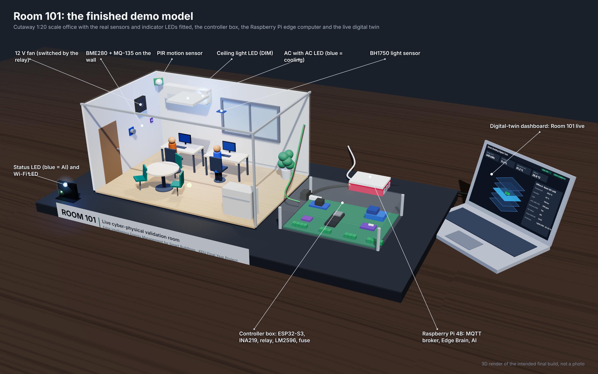

# Edge Intelligence Based Energy Management and Optimization System for Smart Buildings: a Hybrid Cyber-Physical Digital Twin

**Author:** Vinusha Rathnayaka · BSc (Hons) Computer Engineering, General Sir John Kotelawala Defence University · Final Year Project

A five-floor smart building with 26 rooms. **Room 101 is a real room**: an ESP32-S3 node measures it and switches
its fan, lights and indicator LEDs. **The other 25 rooms are simulated** by a physics-based digital twin. A
Raspberry Pi 4B "edge brain" estimates occupancy, decides lighting and air conditioning with an optimiser or a PPO
policy behind a safety layer, keeps learning while it runs, stores history with provenance, and serves a Next.js
dashboard with a 3D digital twin to any phone or laptop on the network.

Every number below comes from a recorded run in `experiments/results/`, `docs/results/` or the commissioning
report. What is real, simulated, predicted or estimated is labelled everywhere ([provenance](#provenance)).



---

## 1. Architecture

```
                 Room 101 (real)                                    Raspberry Pi 4B  (smartbuilding-pi, starts at boot)
ESP32-S3: BME280, BH1750, MQ-135, PIR, INA219,     MQTT + BLE      Mosquitto broker + BLE gateway
          relay + 12 V fan, light / AC / status   ===========>     edge brain (Flask :8001)
          RGB LEDs, 0.96" OLED energy meter        <==========       |- validation, de-duplication, SQLite store (provenance)
          (telemetry every 3 s, commands + ACKs)  both links,       |- Room 101: PIR+CO2 fusion -> multi-objective optimiser -> safety layer
                                                   one msg_id       |- digital twin: 25 rooms, 5R1C physics, AI vs conventional copies
                                                                    |- models (numpy JSON, registry): learned fusion (live, keeps retraining),
                                                                    |  Random Forest, thermal forecast, PPO policy, drift monitor
                                                                    '- API + Server-Sent Events + the dashboard itself  -> http://<pi>:8001/
```

| Part | Where |
|---|---|
| Firmware (ESP32-S3) | `firmware/esp32_smart_building/` |
| Edge brain, MQTT bridge, BLE gateway, MQ-135 CO2 estimator, store | `raspberry_pi/` |
| Digital twin (physics, weather, occupants, sensors, controllers, safety, scenarios) | `twin/` |
| Machine learning (occupancy, thermal, energy, portable models, registry, continual learning) | `ml/` |
| Reinforcement learning (numpy PPO, environment, evaluation) | `rl/` |
| Dashboard and 3D twin | `dashboard/fyp-research-twin/` |
| Wiring, parts list, renders | `docs/wiring/` |

## 2. Room 101 hardware (final build)

| Part | Job | ESP32-S3 pins |
|---|---|---|
| BME280 | temperature, humidity, pressure | I²C SDA 9 / SCL 8 (0x76) |
| BH1750 | light (lux) | I²C (0x23) |
| INA219 | voltage, current, power of the 12 V fan branch (high side) | I²C (0x40) |
| 0.96" OLED (JMD0.96A-2, SSD1306) | energy meter: W, V, mA, Wh, fan, mode | I²C (0x3C) |
| MQ-135 | gas response; the Pi estimates CO2 from it (labelled eCO2) | AO → 10k/15k divider → GPIO1, DO → GPIO2 |
| HC-SR501 PIR | motion / presence | GPIO4 |
| 5 V relay + 12 V 40 mm fan | the room's cooling load (ON/OFF) | GPIO10 (active-LOW) |
| Light RGB LED | the AI's lighting decision (white, OFF / DIM / ON) | GPIO6 / 7 / 5 (PWM) |
| AC indicator RGB LED | what the AC would do (ECO green, LOW cyan, COOL blue, MAX magenta) | GPIO11 / 12 / 13 |
| Status RGB LED | AI blue, schedule green, manual yellow, warning red, no controller blinking red | GPIO14 / 15 / 16 |
| LM2596, 1 A fuse, 1N5822, 470 µF ×2, 100 nF, 1N4007 | power: 12 V in, 5 V rail, protection | see the schematic |

Full circuit, parts list, pin table and expected readings: [docs/wiring/room101-wiring.html](docs/wiring/room101-wiring.html)
(open it in a browser) and [docs/wiring/room101-final-circuit.png](docs/wiring/room101-final-circuit.png).
Bring-up and commissioning: [docs/HARDWARE.md](docs/HARDWARE.md), [docs/COMMISSIONING_REPORT.md](docs/COMMISSIONING_REPORT.md).

**Links.** The board sends every reading over MQTT (Wi-Fi) **and** Bluetooth LE with the same message id; the
edge keeps the first copy. Commands and acknowledgements also travel both ways. Either link alone keeps the room
controlled; with neither, the board switches the fan and lights off and blinks the status LED red.

## 3. Run it

**Final system (Raspberry Pi):** power the Pi and the board. Mosquitto and the `edge-brain` service start at boot
(MQTT bridge, BLE gateway, digital twin, models and the dashboard). Open **http://172.16.0.57:8001/** (the Pi's address) from any device
on the same network.

```
# on the Pi, once
python3 -m venv .venv && .venv/bin/pip install -r requirements/edge.txt      # flask, numpy, paho-mqtt, bleak, scikit-learn
bash scripts/build_dashboard_for_pi.sh      # or copy a built dashboard_dist/ from a PC
systemctl --user enable --now edge-brain    # raspberry_pi/systemd/edge-brain.service
```

**Development PC (Windows):** `run_local.bat` starts the edge brain and the dashboard locally
(http://localhost:3000); `run_local.bat virtual` adds the virtual board that replays real data as Room 101.
Firmware: open `firmware/esp32_smart_building/` in the Arduino IDE (ESP32 core 3.3.x; libraries Adafruit BME280,
INA219, SSD1306, GFX, BH1750, PubSubClient, ArduinoJson), copy `secrets.example.h` to `secrets.h`, flash.

| URL on the Pi | What |
|---|---|
| `/` | dashboard with the 3D twin |
| `/health` | edge brain health |
| `/api/stream` | Server-Sent Events stream the dashboard uses |
| `/api/models` | registry, live models, continual learning rounds, drift |
| `/api/hardware/co2` | MQ-135 eCO2 estimator state and calibration |

## 4. Intelligence

* **Occupancy (simulated rooms):** a learned PIR+CO2 fusion (gradient-boosted trees) drives the AI's
  P(occupied). It **keeps learning while the system runs**: every room-minute is stored with the simulator's true
  label; every 24 simulated hours a new model is trained on older data and tested on the newest data it never saw,
  next to the current model and the hand-built rule on the same rows. It goes live only if it is better and passes
  the registry's acceptance tests; otherwise the current model stays (`ml/online_learning.py`, status in the
  dashboard's Models & data tab, rollback with `python -m ml.registry rollback occupancy_twin_fusion`).
* **Occupancy (Room 101):** PIR + CO2 fusion with a 15-min vacancy rule. The real room has no ground-truth labels,
  so it does not retrain itself on its own guesses; its readings are stored for supervised retraining.
* **Control:** multi-objective optimiser (energy, comfort, light, air quality, switching; 30-min look-ahead) or the
  PPO policy (simulated rooms), always behind the input guard and safety layer. PPO's reward:
  `-(1.0·energy + 2.0·comfort severity + 1.0·uncomfortable time + 1.0·light shortfall + 1.0·CO2 > 1000 ppm + 0.1/0.3 per light/AC switch)`.
  Reinforcement learning explores, so it trains only in the simulator and is deployed through an acceptance test.
* **CO2 (Room 101):** estimated from the MQ-135 (Rs → ppm curve with temperature/humidity correction and automatic
  baseline at 420 ppm), always labelled `mq135_estimate` / eCO2.

## 5. Results

### Machine learning (held-out data)

| Model | Test | Result | Baseline |
|---|---|---|---|
| Occupancy Random Forest (`occupancy_rf`, real UCI office) | week 11-18 Feb 2015, never seen in training | **accuracy 98.9 %**, F1 0.973, AUC 0.997 | - |
| Occupancy, gradient boosting + trends (`occupancy_best`) | same week | F1 0.981, AUC 0.998 | - |
| Learned PIR+CO2 fusion (`occupancy_twin_fusion`), simulated rooms | unseen seed and controller | F1 0.962 | hand-built fusion F1 0.932 |
| Same, live in the AI controller (experiment 12) | 3 seeds × 7 days | **accuracy 96.9 %** (98.9 % in rooms people stay in), F1 0.970 | hand-built 92.5 %, F1 0.932 |
| Room temperature 30 min ahead (`thermal_h30`, live) | unseen seeds | MAE 0.267 K | persistence 0.341 K |
| Day-ahead hourly electricity (`energy_dayahead`) | BDG2, Jun-Dec 2017 | CV(RMSE) 15.4 % | seasonal naive 22.5 % |

### Control (digital twin, 7 days × 3 seeds, matched conditions)

| Controller | Energy, 7 days (kWh) | vs schedule | Occupied time with \|PMV\| > 0.5 |
|---|---|---|---|
| Conventional schedule | 10,964 ± 76 | 0.0 % | 21.7 % |
| Original Random Forest rule | 11,836 ± 113 | -7.9 % | 36.9 % |
| Multi-objective, hand-built fusion | 10,120 ± 109 | +7.7 % | 13.6 % |
| **Multi-objective, learned fusion (live configuration)** | **10,033 ± 84** | **+8.5 %** | **13.0 %** |
| PPO v2 | 9,721 ± 92 | +11.3 % | 5.2 % |

All scenarios (weather, occupancy, faults): [experiments/results/SUMMARY.md](experiments/results/SUMMARY.md);
experiment 12: [experiments/exp12_learned_fusion/README.md](experiments/exp12_learned_fusion/README.md).
These are simulation results under identical conditions, not a savings forecast for a real building.

### Room 101 live (23 Nov 2026)

95 readings in 297 s over MQTT + BLE, 94 of 95 commands acknowledged; 60 s with MQTT cut: all readings and an RGB
command over BLE; Pi reboot: everything back without touching the board. Details:
[docs/COMMISSIONING_REPORT.md](docs/COMMISSIONING_REPORT.md).

## <a id="provenance"></a>6. What is real, simulated, predicted, estimated

| Class | Examples | Shown as |
|---|---|---|
| `room101_measured` | the board's readings | LIVE |
| `synthetic` | the 25 simulated rooms, test senders, virtual board | SIMULATED / VIRTUAL BOARD |
| `prediction` | occupancy probability, 30-min forecast | estimate / forecast |
| estimate | Room 101 CO2 from the MQ-135 | eCO2 (MQ-135) |
| `public_real` | UCI occupancy, BDG2 (training and evaluation only) | model cards |

## 7. Tests and reproduction

```
python -m pytest -q                         # unit, integration and end-to-end tests (docs/TESTING.md)
python firmware/tools/check_firmware.py     # host-side firmware syntax / library-API check
python experiments/run.py --all             # experiments 1-11
python experiments/exp12_learned_fusion/run_exp12.py mo_learned 1 7 7
```

## 8. Known limitations

* The 25 simulated rooms use a 5R1C thermal model with synthetic weather and stochastic occupants; models trained
  on them learn the simulator.
* Room 101's CO2 is an estimate from a metal-oxide sensor, not an NDIR measurement.
* The real room has no labelled occupancy data, so its occupancy estimator does not retrain itself.
* PPO is one policy shared by the simulated rooms, not a multi-agent system, and is trained offline.
* Research prototype without safety certification; the 12 V fan branch is low-voltage DC only.
