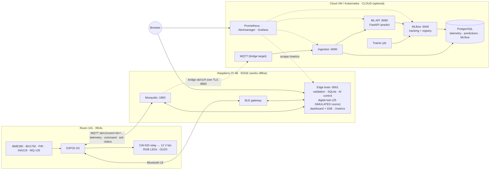
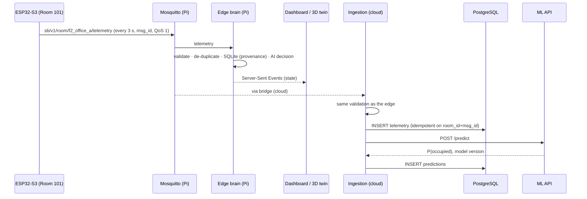
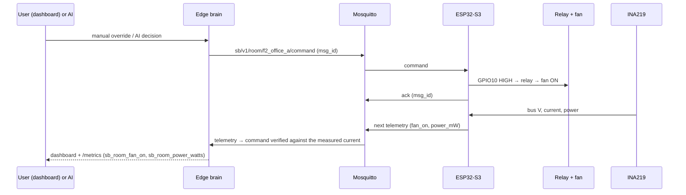
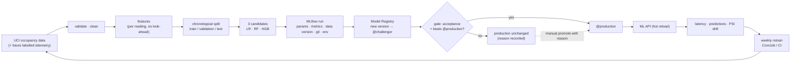
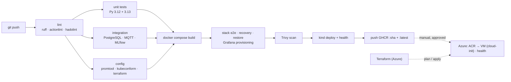

# Architecture

Edge AI + IoT + cyber-physical digital twin, with the DevOps and MLOps platform around it.
Starting point and gap analysis: [AUDIT.md](AUDIT.md). Evidence for every claim: [evidence/](evidence/).

## What is what

| Label | Meaning here | Examples |
|---|---|---|
| **REAL** | measured by hardware in Room 101 | BME280 temperature/humidity, BH1750 lux, PIR, INA219 fan-branch V/I/P, relay state, MQ-135 raw mV |
| **SIMULATED** | produced by software | the 25 digital-twin rooms (5R1C physics), the board simulator (`mqtt_device_sim.py`, `virtual_board.py`) |
| **ESTIMATED** | derived from a real signal with a model | eCO2 from the MQ-135 (provisional, not a ppm measurement) |
| **PREDICTED** | model output | occupancy probability, 30-min temperature, PPO actions |
| **EDGE** | runs on the Raspberry Pi 4B, keeps working without Internet | Mosquitto, edge brain (control loop, twin, store, dashboard), BLE gateway |
| **CLOUD** | runs on the cloud VM / Kubernetes, optional | MLflow, ML API, ingestion + PostgreSQL, Prometheus/Alertmanager/Grafana |
| **AI** | decision making | multi-objective optimiser, PPO policy, safety layer R1–R4 |
| **ML** | learned models | learned occupancy fusion, Random Forest, thermal forecast, MLflow `room-occupancy` |
| **DEVOPS** | how software is built, shipped and run | Git, GitHub Actions, Docker, GHCR/ACR, Compose, Kubernetes, Terraform, monitoring |
| **MLOPS** | how models are built, shipped and watched | data validation, MLflow tracking + registry, promotion gate, FastAPI serving, drift, retraining |

Simulated values never carry the `physical` label: metrics use `source="physical" | "simulated_board" | "simulated"`,
the database uses `provenance`, the dashboard shows LIVE vs SIMULATED.

## System

The cloud side is additive: if the Internet or the VM is down, Room 101 keeps being sensed, decided and actuated
by the Pi. The bridge queues messages (QoS 1, persistent session) and delivers them when the link returns.

## Data flow (sensor → digital twin)

## Control loop (twin / AI → fan → energy feedback)

## ML lifecycle

## DevOps pipeline

## Repository map

The brief's target layout and where each part lives (files were not moved: the Pi, scripts and thesis use these paths).

| Target | Here |
|---|---|
| `esp32/` | `firmware/esp32_smart_building/` |
| `edge/mqtt`, `edge/services` | `raspberry_pi/` (edge brain, MQTT bridge, BLE gateway, store, metrics), `infrastructure/mosquitto/` |
| `edge/ingestion` | `ingestion/` |
| `backend/api` | `raspberry_pi/edge_brain.py` (Flask, SSE), `mlops/serving/` (FastAPI) |
| `frontend/` | `dashboard/fyp-research-twin/` |
| `simulation/` | `twin/` |
| `ai/` | `rl/` (PPO), `twin/controllers.py`, `twin/safety.py` |
| `mlops/` | `mlops/` (data, train, promote, serving), `ml/` (edge models, registry, drift) |
| `infrastructure/docker`, `terraform`, `kubernetes` | `infrastructure/` |
| `monitoring/` | `monitoring/` (Prometheus, Alertmanager, Grafana) |
| `.github/workflows` | `.github/workflows/` |
| shared helpers | `sbops/` (JSON logs) |

## Ports

| Port | Service | Exposure |
|---|---|---|
| 1883 | Mosquitto (password + ACL) | edge LAN only |
| 8883 | Mosquitto TLS (bridge) | cloud VM, from the edge's IP only (NSG) |
| 8001 | edge brain + dashboard | edge LAN / `BIND_ADDR` |
| 8080 | ML API | localhost / cluster / reverse proxy |
| 8090 | ingestion health + metrics | internal |
| 5000 | MLflow | localhost / reverse proxy |
| 5432 | PostgreSQL | internal (127.0.0.1 in Compose) |
| 9090 / 9093 / 3000 | Prometheus / Alertmanager / Grafana | localhost / reverse proxy |
